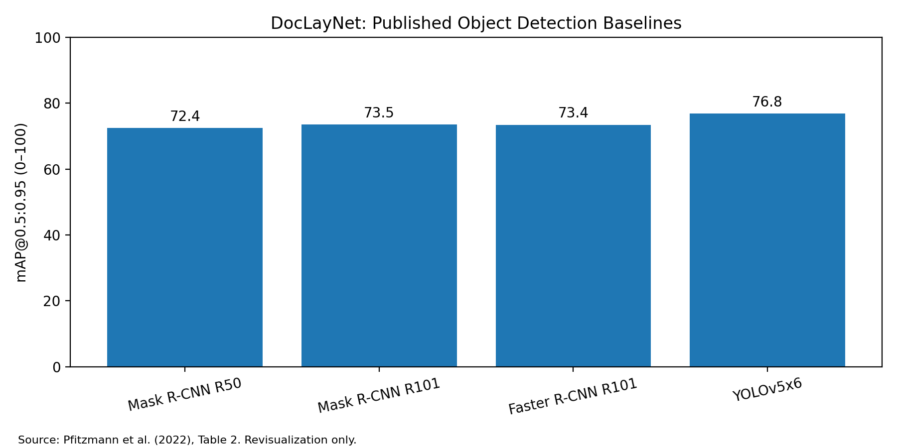

# Document Layout Analysis Review

**Tiếng Việt:** Phân tích các phương pháp học sâu trong nhận diện bố cục tài liệu: kiến trúc, bộ dữ liệu và thách thức tổng quát hóa.

**Tác giả:** Lê Gia Lâm  
**Đơn vị:** Đại học Cần Thơ, Việt Nam  
**Học phần:** Công nghệ số nâng cao — Bài thực hành 04, Yêu cầu 4

## Giới thiệu

Dự án học thuật tổng quan các phương pháp học sâu trong phân tích bố cục tài liệu (Document Layout Analysis), tập trung vào các mô hình phát hiện đối tượng như Faster R-CNN, Mask R-CNN và YOLOv5; đồng thời thảo luận các hướng khai thác đặc trưng văn bản–hình ảnh–vị trí.

Công trình trung tâm là *DocLayNet* của Pfitzmann và cộng sự (KDD 2022, DOI: [10.1145/3534678.3539043](https://doi.org/10.1145/3534678.3539043)).

## Mục tiêu

- Tóm lược các phương pháp phân tích bố cục tài liệu bằng học sâu.
- So sánh các kết quả **đã công bố** trên DocLayNet, không trình bày như kết quả huấn luyện mới.
- Phân tích ảnh hưởng của cách gán nhãn, chia tập dữ liệu và thay đổi miền tài liệu đến đánh giá mô hình.
- Lưu trữ bài tổng quan, poster, số liệu tổng hợp và mã nguồn minh họa một cách minh bạch, có thể kiểm tra.

## Phương pháp

Tổng quan tài liệu có cấu trúc; đối chiếu thông tin từ các công bố học thuật và tái trực quan hóa số liệu công khai. **Repository này không chứa mô hình đã huấn luyện và không tuyên bố đã chạy lại thí nghiệm DocLayNet.**

## Kết quả tham khảo từ nghiên cứu gốc

Trên tập kiểm thử DocLayNet, mAP@0.5:0.95 được báo cáo lần lượt: Mask R-CNN R50 **72,4**, Mask R-CNN R101 **73,5**, Faster R-CNN R101 **73,4** và YOLOv5x6 **76,8** (Pfitzmann et al., 2022, Bảng 2). Đây là **điểm mAP theo thang 0–100**, không phải phần trăm độ chính xác phân loại.

## Cấu trúc

```text
document-layout-analysis-review/
├── README.md
├── LICENSE
├── CONTRIBUTING.md
├── CITATION.cff
├── .gitignore
├── requirements.txt
├── data/
│   └── SOURCES.md
├── src/
│   └── plot_baselines.py
├── docs/
│   └── README.md
└── results/
    └── README.md
```

## Tạo biểu đồ minh họa

```bash
python -m pip install -r requirements.txt
python src/plot_baselines.py
```

Lệnh tạo `results/doclaynet_baselines.png` từ **số liệu đã xuất bản**, không huấn luyện mô hình mới.

### Biểu đồ so sánh kết quả DocLayNet



*Nguồn: Pfitzmann và cộng sự (2022), Bảng 2. Biểu đồ tái trực quan hóa kết quả đã công bố, không phải kết quả huấn luyện mới.*

## Nguồn và giấy phép

- **Mã nguồn, phần diễn giải tự viết và hình vẽ do tác giả repository tạo:** MIT License — xem [LICENSE](LICENSE).
- **DocLayNet, bài báo, ảnh gốc và các tài liệu bên ngoài:** giữ nguyên quyền tác giả và điều kiện cấp phép riêng của bên cung cấp; **không tự động thuộc MIT License của repository này**. Xem [data/SOURCES.md](data/SOURCES.md).
- Không tải lại nguyên bộ dữ liệu hoặc bản PDF của bên thứ ba lên repository khi chưa xác minh quyền phân phối.

## Đóng góp và trích dẫn

Xem [CONTRIBUTING.md](CONTRIBUTING.md) để biết cách đóng góp và [CITATION.cff](CITATION.cff) để trích dẫn repository. Khi sử dụng số liệu DocLayNet, **đồng thời trích dẫn công bố gốc**.

**DocLayNet:** Birgit Pfitzmann, Christoph Auer, Michele Dolfi, Ahmed S. Nassar, Peter Staar (2022), *DocLayNet: A Large Human-Annotated Dataset for Document-Layout Segmentation*, KDD 2022, DOI: [10.1145/3534678.3539043](https://doi.org/10.1145/3534678.3539043).
